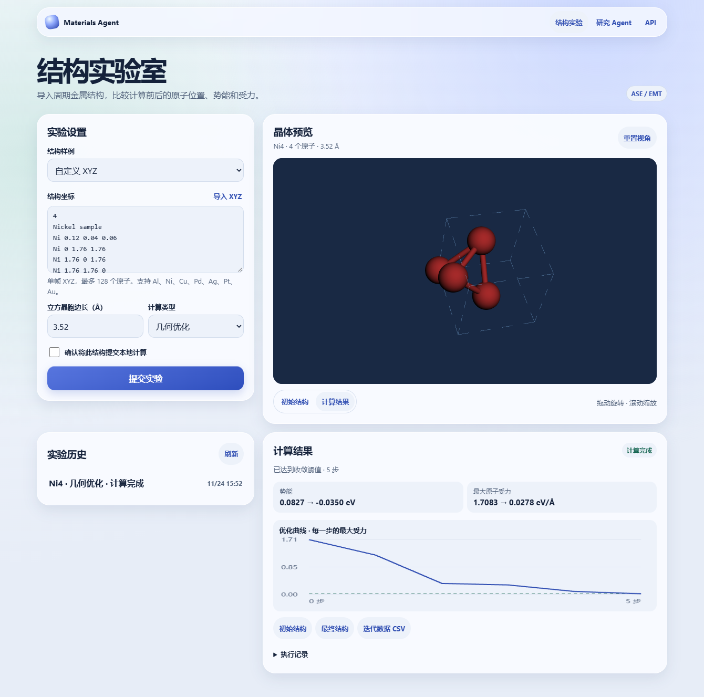

# 材料计算 Agent

一个本地材料计算工作台。可以查材料资料，也可以导入 XYZ 做单点能量计算或结构优化。计算完成后，可以对照初始和最终结构，下载结构文件与逐步计算记录。

[其他项目](docs/projects.md) · [开源依赖与代码参考](docs/open-source-references.md)



## 运行

需要 Python 3.11 或更新版本，以及 [uv](https://docs.astral.sh/uv/)。

```sh
uv sync --locked
uv run --locked uvicorn materials_agent.api:app --host 127.0.0.1 --port 8000
```

打开 [结构实验室](http://127.0.0.1:8000/) 可以直接用铜、铝或镍样例，也可以导入自己的 XYZ。[研究 Agent](http://127.0.0.1:8000/agent) 可以先查资料，再由用户确认是否提交计算。本地试用无需模型密钥。

## 项目实现

- **材料计算**。用 ASE 的 EMT 经验势计算能量和受力，用 BFGS 优化固定晶胞内的原子坐标。铜晶胞样例优化 6 步，最大原子受力从约 1.11 降至 0.0107 eV/Å。可以用 3Dmol.js 查看前后结构，导出 extxyz 和逐步 CSV。
- **证据核验**。回答会保留检索出处。核验模式检查引用 ID 及所引原文，失败时换一种检索策略再查一次，资料仍不足就拒答。
- **任务恢复**。LangGraph 保存审批前后的运行状态，SQLite 保存后台任务和事件。重复提交会复用任务，执行进程中断后可以重新领取。页面通过 SSE 更新进度，断线后按事件 ID 补读。

目前是单机实现。结构实验支持 7 种金属、最多 128 个原子，使用固定立方周期晶胞。默认使用离线路由，提供可配置的 Chat Completions 适配器。启动后可访问 [API 文档](http://127.0.0.1:8000/docs)。

```sh
uv run --locked pytest -q
```
